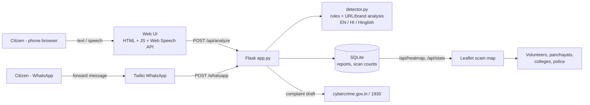
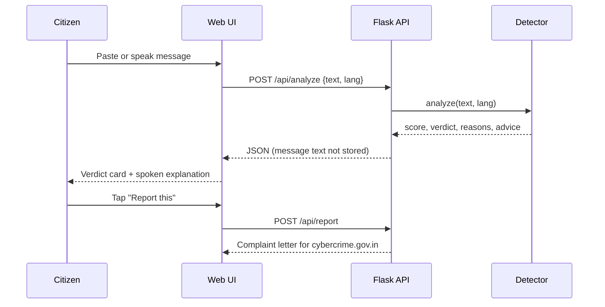
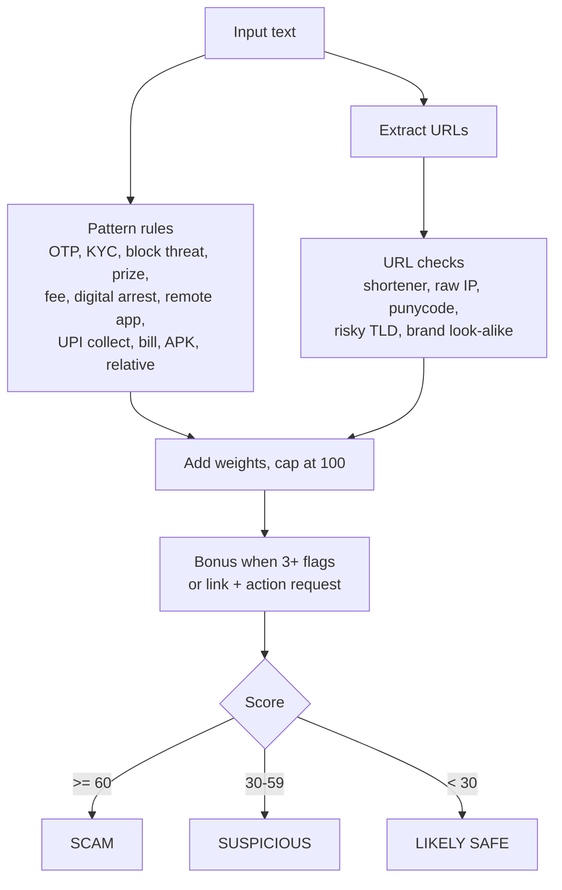

# Technical Design Document – Suraksha Saathi

## 1. Goal
Protect first-time digital users from cyber fraud by checking messages in their own language, explaining the risk by voice/text, filing the complaint, and mapping hotspots for awareness drives.

## 2. System architecture

## 3. Message-check flow

## 4. Detection engine (detector.py)

Every matched rule carries a bilingual reason string, so the verdict is fully explainable.

## 5. Data model (SQLite)
| Table | Columns |
|---|---|
| `reports` | id, city, lat, lng, category, amount, created, sample (1 = seed data) |
| `scans` | id, verdict, created |
Message text is never persisted.

## 6. API
See README → API table. All JSON except `/whatsapp` (TwiML XML).

## 7. Design decisions
* **Rule-based, explainable engine:** no GPU or paid API, works on low-cost servers, every score can be justified to the user.
* **Browser Web Speech API:** zero-cost Indian-language voice input/output without extra infrastructure.
* **SQLite:** zero-setup storage suitable for a pilot; swap for PostgreSQL by changing `db()`/`init_db()`.
* **Privacy by design:** no message storage, no login, city-level location only.

## 8. Security & privacy
Input length capped (4000 chars); parameterised SQL; HTML-escaped output in the UI; amounts clamped; report city validated against an allow-list.

## 9. Testing
`python -m unittest discover -s tests -v` covers scam and safe messages, look-alike domains, Hindi output, all API routes, the WhatsApp webhook, and the labelled file `data/sample_messages.json`.

## 10. Scalability / roadmap
Learned classifier blended with rules, Bhashini for 22 languages, Android call overlay, PostgreSQL + dashboards for district authorities.
